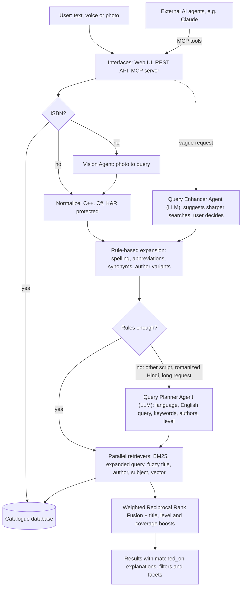

# Agentic Search – Find Book Your Way

**Agentic AI-powered hybrid search for library catalogues, usable by people and by AI agents (MCP).**

🏆 **Winner, Best Ideathon Award and 1st Prize** at IIT Delhi's *"ETDs in the Age of AI"* event.

## 🎥 Videos and Documents

| | |
|---|---|
| 🎤 **IIT Delhi Presentation** (full presentation on the Central Library IIT Delhi channel) | [Watch on YouTube](https://www.youtube.com/live/OS07hUWVgqc?si=1dZrOgBnpEg3bDW5&t=21947) |
| 🖥️ **Project Demo Video** | [Watch the demo](YOUR_DEMO_VIDEO_LINK) |
| 📄 **Product Demonstration (PDF)** | [Product Demonstration PDF.pdf](Product%20Demonstration%20PDF.pdf) |
| 📊 **Presentation slides (PPTX)** | [Search_Beyond_Text_Enhanced.pptx](Search_Beyond_Text_Enhanced.pptx) |


---

## Product Overview

**Problem.** Library search fails when the user's words differ from the catalogue record: typos ("pyhton"), abbreviations ("DSA"), synonyms, transliterated author names, regional languages and scripts (Hindi, Urdu, Arabic), vague natural-language requests, or a photo of a syllabus. Plain keyword search returns nothing, so readers give up on books the library actually holds.

**Solution.** An agentic search built on a hybrid approach. Deterministic rules (fast, free, explainable) handle clean queries. Specialised LLM agents plan, rewrite and interpret the query only when the rules cannot cope. Every result carries `matched_on` reasons, for example `spelling: pyhton→python` or `author variant: tchebychev→Chebyshev`, so librarians can see why a book appeared.

### 🧠 Partial-memory search
Readers often remember a book only in fragments: the colour of the cover, a picture on it, a rough topic, the author's first name or half a title, but not the name. They can type what they remember ("that Python book with the black cover"), speak it, or upload a photo. The system matches those fragments against the catalogue instead of demanding an exact title.

### 🎯 Intent-based search
Ask in plain language, such as "I need beginner Python books" or "a book to learn pointers and memory management in C". The system works out the intent (topic, skill level, author, language) instead of matching keywords, and applies it as filters and ranking boosts.

---

## Architecture



### Key components

| Module | Component | Function |
|---|---|---|
| Query Understanding | Rule-based text engine | Normalizes text, corrects spelling, expands abbreviations (DSA, OOP), synonyms and author-name variants (Double Metaphone). |
| Query Planner Agent | LLM query planner | Runs only when rules fall short. Returns a JSON plan: language, English query, keywords, authors, level. |
| Query Enhancer Agent | LLM query rewriter | Rewrites vague requests into better searches grounded in the catalogue's real subjects. Applies nothing without user consent. |
| Vision Agent | Vision model | Reads a photo of notes, a cover or a syllabus and turns it into a search query. |
| Hybrid Retrieval + Fusion | Multi-retriever ranking engine | Several retrievers merged by weighted Reciprocal Rank Fusion. |
| Indexer / Authority Data | Index builder and data layer | Builds full-text and vector indexes. Thesaurus, abbreviation and author tables are extended through admin endpoints. |
| Interfaces | REST API, web UI, MCP server | FastAPI endpoints, a browser UI and an MCP server exposing 6 tools to external AI agents. |

### Tech stack
- **Backend:** Python 3.12, FastAPI, Uvicorn, Pydantic
- **Storage and retrieval:** SQLite with FTS5 (BM25, fuzzy) and `sqlite-vec` for vectors. All SQL is in one repository module, so moving to **PostgreSQL with pgvector** (full-text search, `pg_trgm`) replaces that one file.
- **AI models:** OpenAI-compatible API (configurable base URL). `text-embedding-3-small` for embeddings and `gpt-4o-mini` for planning, query enhancement and vision.
- **NLP libraries:** rapidfuzz, wordfreq, metaphone, unidecode
- **Agent interface:** MCP server over stdio or Streamable HTTP (`/mcp/`)
- **Quality:** pytest suite (OpenAI mocked) and an evaluation harness reporting hit@5 and MRR per query category

---

## Key Features

- **Partial-memory search:** find a book without its name, using cover colour, what you remember of the cover, half a title, the author's first name, the topic or the story.
- **Intent-based natural-language search:** ask the way you would ask a librarian. The Planner Agent extracts topic, level, author and language, and the Query Enhancer can sharpen a vague need.
- **Multilingual and voice-tolerant:** Hindi, Marathi, Bengali, Urdu, Tamil and other scripts, Hinglish, and speech errors ("see plus plus" = C++, "pie thon" = Python).
- **Explainable results:** each hit lists why it matched.
- **Cost-aware AI:** LLM calls run only for hard queries. Clean keyword queries stay on the rule path with no model cost.
- **Human-in-control enhancement:** the Query Enhancer proposes rewrites, filters and alternatives with book counts, and the user decides.
- **Subject hierarchy:** LCSH-style headings, so a broader heading also finds books under its narrower headings.
- **Librarian-managed authority data:** token-protected admin APIs extend the thesaurus, abbreviations and author variants, then reindex, with no code change.
- **Image search and availability:** photos of covers or notes become queries. Records show copies and shelf location (synthetic in the demo).
- **Agent-ready:** any MCP client can search, browse and look up books as tools.

---

## Getting Started

```bash
python3 -m pip install --user uv            # or: brew install uv
uv venv -p 3.12 .venv
uv pip install -p .venv/bin/python -r requirements.txt
source .venv/bin/activate

cp .env.example .env                         # add OPENAI_API_KEY for semantic + image search
python scripts/init_db.py
python scripts/load_seed.py
python scripts/build_index.py
uvicorn app.main:app --reload
```

Open http://localhost:8000. Interactive API docs are at http://localhost:8000/docs.

### Use it from an MCP client

- **Streamable HTTP:** start the server and point the client at `http://localhost:8000/mcp/`.
- **stdio** (for example in the Claude Desktop config):

```json
{
  "mcpServers": {
    "library-search": {
      "command": "/path/to/LIB_SEARCH/.venv/bin/python",
      "args": ["-m", "app.mcp_server"],
      "cwd": "/path/to/LIB_SEARCH"
    }
  }
}
```

**MCP tools:** `search_books`, `search_books_by_image`, `enhance_query`, `get_book`, `browse_subjects`, `suggest`.

### Tests

```bash
python -m pytest             # unit + API + MCP tests; OpenAI is mocked
python tests/run_eval.py -v  # hit@5 / MRR per query category
```

---

## Demo data

65 books (60 programming titles and 5 Hindi novels), 24 authors with spelling variants and native-script forms, LCSH-style subject headings, about 35 thesaurus groups and 31 abbreviations. Titles and authors are real works. ISBNs, copy counts and shelf locations are synthetic demo values.
